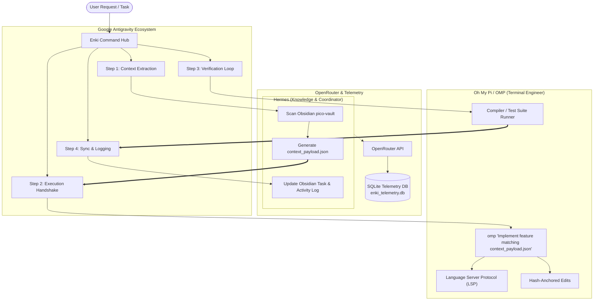

# 🏛️ ENKI - The Dual-Agent Command Hub

> *Named after Enki, the ancient Mesopotamian god of wisdom, water, crafts, organization, and civilization.*

Enki is an automated dual-agent command hub designed within the **Google Antigravity** ecosystem. It coordinates administrative knowledge indexing and strict software engineering execution across two specialized sub-agents:

1. **Hermes** (*Personal Assistant & Knowledge Agent*): Indexes your local markdown notes in Obsidian (`pico-vault`), parses incoming feature requests, extracts engineering constraints, and generates structured `context_payload.json`. **Never writes production code.**
2. **Oh My Pi / OMP** (*Terminal Coding Agent*): Consumes structured technical constraints, hooks into active LSPs, runs test suites and debuggers, and executes hash-anchored code modifications in terminal workspaces.

---

## 📐 System Architecture



---

## ⚡ The 4-Step Pipeline

| Step | Action | Responsible Agent | Output |
| :--- | :--- | :--- | :--- |
| **1. Context Extraction** | Crawls `pico-vault` markdown notes and extracts engineering constraints | **Hermes** | `context_payload.json` |
| **2. Execution Handshake** | Antigravity dispatches payload to OMP via CLI wrapper | **Antigravity -> OMP** | `omp "Implement feature matching context_payload.json"` |
| **3. Verification** | Iterates on local compilers and test suites (`pytest`, `cargo test`, `npm test`) | **OMP** | Test logs & exit codes |
| **4. Sync & Logging** | Updates Obsidian task checklist and logs execution metrics | **Hermes** | `01_Dashboard/Enki_Activity_Log.md` |

---

## 🚀 Quickstart & Commands

The hub can be driven either end-to-end or step-by-step:

### 1. End-to-End Automated Pipeline
```powershell
py enki.py run "Build normalization and deduplication pipeline for Dinner Service Optimizer"
```

### 2. Step-by-Step Invocation
```powershell
# Step 1: Extract context and generate payload
py enki.py context "Define schema and data contracts for Dinner Service Optimizer"

# Step 2: Feed payload to OMP CLI
py enki.py handshake

# Step 3: Run test suite verification
py enki.py verify

# Step 4: Sync completion to Obsidian
py enki.py sync
```

### 3. AI Model Gateway Management (OpenRouter & OpenCode Zen)
Enki supports multiple AI model gateways. Inspect and switch active gateways on the fly:
```powershell
# View all configured gateways and their status
enki gateway

# Switch active gateway to OpenCode Zen
enki gateway --set opencode_zen

# Switch active gateway back to OpenRouter
enki gateway --set openrouter

# Or override on a single task run
enki run --gateway opencode_zen "Implement new feature"
```

### 4. Telemetry & Cost Monitoring
Display prompt/completion tokens, pricing, and monthly budget utilization:
```powershell
enki monitor
```

### 5. System Status
Check active gateway, API key status, active payload, and vault path:
```powershell
enki status
```

---

## ⚙️ Configuration

Settings are maintained in [config/enki.config.json](file:///c:/Users/Christian%20Picofazzi/Documents/Enki/config/enki.config.json) and `.env`:

```json
{
  "hub_name": "Enki Command Hub",
  "active_gateway": "openrouter",
  "gateways": {
    "openrouter": {
      "name": "OpenRouter",
      "base_url": "https://openrouter.ai/api/v1",
      "api_key_env": "OPENROUTER_API_KEY",
      "hermes_model": "nousresearch/hermes-3-llama-3.1-70b",
      "omp_model": "anthropic/claude-3.5-sonnet"
    },
    "opencode_zen": {
      "name": "OpenCode Zen",
      "base_url": "https://opencode.ai/zen/v1",
      "api_key_env": "OPENCODE_API_KEY",
      "hermes_model": "claude-3-5-sonnet",
      "omp_model": "claude-3-5-sonnet"
    }
  },
  "telemetry": {
    "monthly_budget_usd": 25.0
  }
}
```

### Setting your API Keys
Create or edit `.env` in the Enki directory:
```env
# OpenRouter Gateway
OPENROUTER_API_KEY=sk-or-v1-...

# OpenCode Zen Gateway (https://opencode.ai/zen)
OPENCODE_API_KEY=your_opencode_zen_api_key_here
```

---

## 🖥️ User Interfaces

### 1. Terminal UI (Textual)
Enki features a complete 10-screen interactive Terminal UI built with Textual:
```powershell
py enki.py tui
py enki.py tui --dry-run
py enki.py tui --workflow feature_and_reviewer
```
Keybindings:
- `1` - `0`: Navigate directly across all 10 screens (Dashboard, Start Run, Live Run, Payload Editor, Workflows, Models, Obsidian Browser, Telemetry, Run History, Finished Worktrees).
- `q`: Quit application.

### 2. Web UI (FastAPI + React)
Enki provides a browser-based dashboard strictly bound to local loopback (`127.0.0.1`):
```powershell
py enki.py serve --port 8765
```
- **Local Address**: `http://127.0.0.1:8765`
- **Interactive API Docs**: `http://127.0.0.1:8765/docs`
- **Security**: Bound exclusively to loopback; non-local requests are rejected with HTTP 403. Sensitive `.env` API keys are automatically redacted from all API responses and logs.

---

## 🛡️ Budget Enforcement & Safety Guards

- **Real-Time Budget Guard**: Intercepts model calls when monthly spend exceeds `$25.00` (or `monthly_budget_usd`), giving users 3 choices:
  1. `continue`: Proceed beyond budget.
  2. `pause`: Halt execution cleanly.
  3. `switch_cheaper`: Switch model dynamically to a low-cost alternative (e.g. `deepseek/deepseek-chat`).
- **Obsidian File Lock & Atomic Writes**: Cross-process lock prevents vault file corruption during concurrent operations. Checklist updates (`- [ ]` $\rightarrow$ `- [x]`) and activity logs are committed using atomic temp files.
- **Inviolable Agent Boundaries**: Hermes is strictly prohibited from writing code; OMP is strictly prohibited from modifying Obsidian vault notes.
- **Project Exclusions**: `Body.me App` is strictly excluded from all scans, runs, and pickers.

---

## 🔧 Installing Oh My Pi (OMP) on Windows

If `omp` is not yet installed in your system PATH, you can install it using either:

1. **Cargo (Rust)**:
   ```powershell
   cargo install --git https://github.com/can1357/oh-my-pi
   ```
2. **Bun / Node**:
   ```powershell
   bun install -g @oh-my-pi/pi-coding-agent
   ```
*(Note: Enki contains an automatic fallback simulation bridge that allows full pipeline validation even if the OMP binary is not yet compiled on Windows).*
